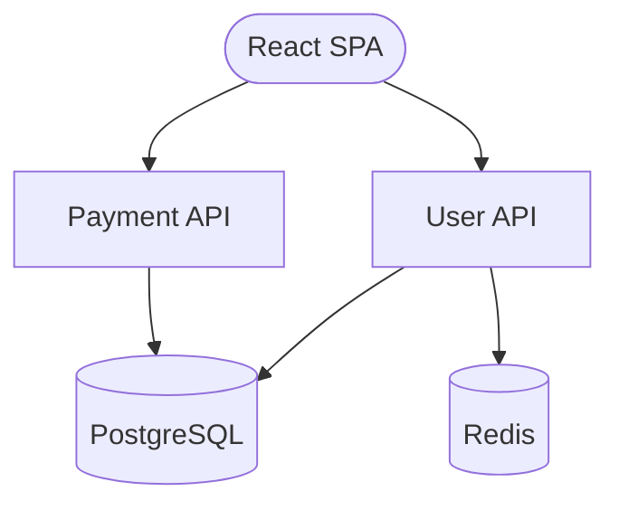

# Brick CLI

[](https://www.npmjs.com/package/brick-cli)
[](https://nodejs.org)
[](https://opensource.org/licenses/MIT)
[](https://www.digitalocean.com/products/app-platform)

**Translate natural language or Mermaid diagrams into deployed DigitalOcean infrastructure.**

Brick is an AI-powered CLI that transforms architecture diagrams into production-ready DigitalOcean App Platform deployments. Describe your infrastructure in plain English or draw it with Mermaid, and Brick handles the rest.

```
$ brick create "A blog with Next.js and PostgreSQL"

Generated Architecture:

flowchart TD
    A[Next.js App] --> B[(PostgreSQL)]

AppSpec written to appspec.yaml

$ brick deploy appspec.yaml
Deploying to DigitalOcean...
App URL: https://blog-app-xxxxx.ondigitalocean.app
```

## Quick Start

### Installation

```bash
npm install -g brick-cli
```

### Prerequisites

- Node.js 18+
- [doctl](https://docs.digitalocean.com/reference/doctl/) (DigitalOcean CLI) installed and authenticated
- An Anthropic API key for AI features

### Your First Deployment

1. **Create from natural language:**
   ```bash
   brick create "A React frontend with a Node.js API and PostgreSQL database"
   ```

2. **Or build from a Mermaid diagram:**
   ```bash
   brick build architecture.mmd -o appspec.yaml
   ```

3. **Deploy to DigitalOcean:**
   ```bash
   brick deploy appspec.yaml
   ```

## Features

- **AI-Powered Design** - Describe your app in plain English and get a complete architecture
- **Mermaid Diagrams** - Use visual flowcharts to define infrastructure
- **Interactive Mode** - Refine your architecture through conversation
- **Cost Estimation** - See estimated monthly costs before deploying
- **Validation** - Catch configuration errors before deployment
- **Visual UI** - Browser-based architecture editor with drag-and-drop
- **Platform Server** - Full API server for team collaboration

## CLI Commands

| Command | Description |
|---------|-------------|
| `brick create <description>` | Generate infrastructure from natural language |
| `brick build <diagram.mmd>` | Compile Mermaid diagram to AppSpec YAML |
| `brick chat` | Interactive mode to design and refine architecture |
| `brick deploy <appspec.yaml>` | Deploy to DigitalOcean App Platform |
| `brick validate <appspec.yaml>` | Validate an AppSpec file |
| `brick ui` | Launch visual architecture editor |
| `brick server` | Start the platform API server |

See the [CLI Reference](docs/cli-reference.md) for detailed options.

## Mermaid Diagram Syntax

Brick uses Mermaid flowchart syntax with shape conventions to infer component types:



| Shape | Component Type |
|-------|---------------|
| `[Rectangle]` | Service (HTTP workload) |
| `([Stadium])` | Static Site (frontend) |
| `[(Cylinder)]` | Database |
| `((Circle))` | Worker (background process) |
| `{{Hexagon}}` | Job (scheduled task) |

## Documentation

- [Getting Started](docs/getting-started.md) - Installation and first deployment
- [CLI Reference](docs/cli-reference.md) - All commands and options
- [Architecture](docs/architecture.md) - How Brick works internally
- [Examples](docs/examples.md) - Common architecture patterns

## Supported Infrastructure

**Compute:**
- Services (HTTP APIs, web servers)
- Static Sites (React, Vue, Next.js, Hugo)
- Workers (background processors)
- Jobs (scheduled tasks, migrations)

**Data:**
- PostgreSQL
- MySQL
- Redis
- MongoDB

**Regions:**
nyc, sfo, ams, sgp, lon, fra, tor, blr, syd

## License

MIT
