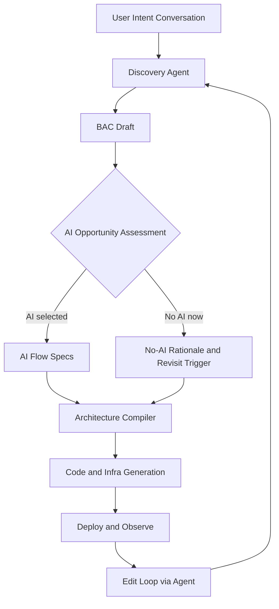
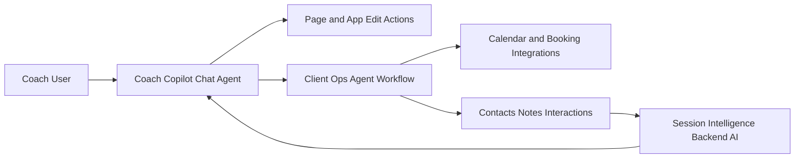

# Brick Architecture Decisions

Last updated: 2026-02-11
Status: Active working document

## Purpose
This document captures architecture decisions for Brick so we do not reset context across sessions.

## Decision Log

### D-001: AI-Native Strategy
- Date: 2026-02-11
- Status: Accepted
- Decision: AI-native implementation is optional per generated product, but AI opportunity assessment is mandatory for every vertical and product.
- Rationale:
  - Some products get major UX and operational leverage from AI-native flows.
  - Some products may not justify AI in v1 due risk, cost, or weak value density.
  - We still need a forced evaluation step so AI is never ignored accidentally.
- Consequence:
  - Every vertical definition must include an AI opportunity assessment.
  - A vertical may choose no AI-native flows only with explicit rationale and revisit trigger.

### D-002: Model Routing Strategy
- Date: 2026-02-11
- Status: Accepted
- Decision: Use OpenRouter as the default model router.
- Rationale:
  - Enables provider/model flexibility behind one integration surface.
  - Reduces coupling between Brick workflows and a single model vendor.
- Consequence:
  - Platform policy in BAC defaults to `modelRouter: openrouter`.
  - Runtime model selection can vary by task without changing calling code.

### D-003: Change Application Strategy
- Date: 2026-02-11
- Status: Accepted
- Decision: Default to targeted file edits over full regeneration.
- Rationale:
  - Preserves existing work and minimizes regression risk.
  - Improves iteration speed and reduces churn in generated code.
- Consequence:
  - BAC platform policy defaults to `defaultEditStrategy: targeted_edit`.
  - Generation pipelines should only regenerate changed/impacted files unless full regeneration is explicitly requested.

### D-004: Contract-First Node and Edge Interfaces
- Date: 2026-02-11
- Status: Accepted
- Decision: BAC must include explicit input/output contracts for each system node and data contracts for each edge.
- Rationale:
  - Enables independent agent implementation per node while enforcing integration guarantees.
  - Prevents architecture drift where edges exist but payload expectations are implicit.
- Consequence:
  - BAC now includes `systemContracts.nodes` and `systemContracts.edges`.
  - A node implementation is valid only if it satisfies its declared input/output contract.
  - Edge contracts define source output and target input expectations as the contract-of-record.

## Canonical Abstraction

### Brick App Contract (BAC)
BAC is the single source of truth that all generation and orchestration compile from.



### BAC Required Sections
- Product outcome and user jobs.
- Domain model and core entities.
- Core workflows.
- Integration requirements.
- Runtime and deployment constraints.
- Observability and quality gates.
- System node contracts (required).
- System edge data contracts (required for connected nodes).
- AI opportunity assessment (required).
- AI flow specs (optional, required if AI selected).

## AI Opportunity Assessment (Required)

For each major workflow:
- Workflow name.
- Current pain or bottleneck.
- AI leverage score (Low, Medium, High).
- Proposed AI mode:
  - `chat_agent`
  - `agent_workflow`
  - `backend_ai_service`
  - `none_for_now`
- Expected value:
  - Time reduction.
  - Quality uplift.
  - Revenue or retention impact.
- Risk profile:
  - Safety and compliance.
  - Hallucination or reliability risk.
  - Data sensitivity.
- Decision:
  - `include_in_v1`
  - `defer_to_v2`
  - `exclude`
- Reason and revisit trigger.

## AI Flow Specification (When Included)

Each AI flow must define:
- Flow ID and name.
- Type (`chat_agent`, `agent_workflow`, `backend_ai_service`).
- Trigger.
- Inputs and context sources.
- Allowed tools/actions.
- Output contract.
- Guardrails and policy constraints.
- Fallback behavior.
- Success metrics.
- Audit trail requirements.

### AI Flow Contract Template
```yaml
id: flow_id
name: human_readable_name
type: chat_agent | agent_workflow | backend_ai_service
trigger: user_action | schedule | event
context_sources:
  - source_name
tools:
  - name: tool_name
    scope: read | write | execute
output_contract:
  format: json | markdown | structured_event
  fields:
    - field_name
guardrails:
  - policy_rule
fallback:
  strategy: human_review | deterministic_rule | no_op
success_metrics:
  - metric_name
audit:
  log_inputs: true
  log_outputs: true
  log_actions: true
```

## Vertical Baseline: Coach Platform

### Context
Coach platform manages clients, notes, meetings, bookings, and marketing pages.

### Initial AI Opportunity Assessment
- Client operations and follow-up: High.
- Booking and scheduling orchestration: Medium to High.
- Landing page iteration via natural language: High.
- CRM data summarization and recommended next actions: High.

### Candidate AI Flows


- `coach_copilot`: coach describes page or product updates in plain language; agent proposes and applies safe patches.
- `client_ops_agent`: event or schedule-triggered workflows for follow-ups, reminders, and meeting prep.
- `session_intelligence`: backend summarization and recommendation layer over interactions.

## Platform Requisite Parts

### 1) Discovery and Planning Layer
- Conversational requirements capture.
- BAC drafting and versioning.
- AI opportunity assessment enforcement.

### 2) Compile Layer
- BAC to architecture graph.
- Architecture graph to code and infra specs.
- Validation, policy checks, and risk gates.

### 3) Runtime Agent Substrate
- Model routing.
- Context and memory retrieval.
- Tool execution control plane.
- Guardrails and policy engine.
- Evaluation hooks and telemetry.

### 4) Operate and Iterate Layer
- Deployment orchestration.
- Runtime monitoring and cost telemetry.
- Conversational change requests mapped to targeted edits.
- Safe rollback and diff review.

## Governance Rules
- Every new vertical must include AI opportunity assessment.
- "No AI in v1" is valid only with explicit rationale.
- All AI-enabled flows need fallback and audit definitions before production.
- Design and implementation should preserve a single abstraction: conversation -> BAC -> compiler -> deployed system -> conversation.

## Open Questions
- What BAC schema format should be canonical in code (`yaml` vs `json` vs typed TS object)?
- What minimum guardrail policy must be globally enforced across all verticals?
- What default evaluation bundle is required for any AI-enabled flow?
