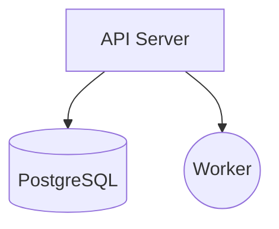
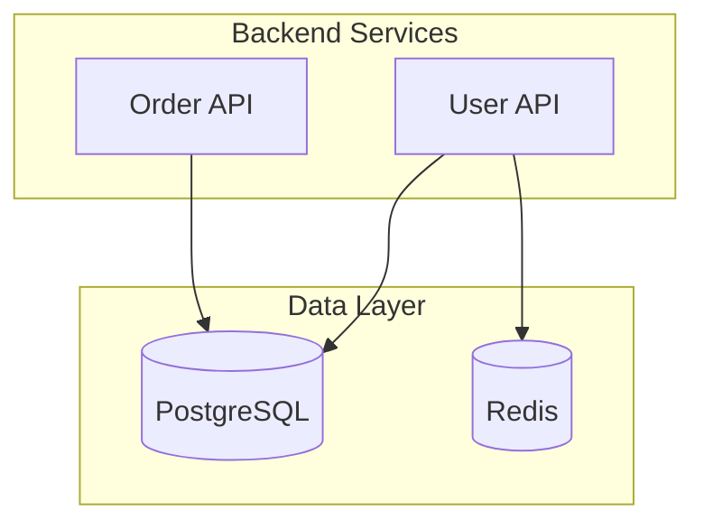

# How Brick Works

This document explains Brick's internal architecture and the pipeline that transforms diagrams into deployable infrastructure.

## Overview

Brick follows a three-stage pipeline:

```
Mermaid Diagram  -->  Parser  -->  AST
                                    |
                                    v
                              Transformer  -->  IR (Intermediate Representation)
                                                |
                                                v
                                           Generator  -->  AppSpec YAML
                                                              |
                                                              v
                                                           Deployer  -->  DigitalOcean
```

## Pipeline Stages

### 1. Parser

**Location:** `src/parser/`

The parser converts Mermaid flowchart syntax into an Abstract Syntax Tree (AST).

**Input:** Mermaid diagram string


**Output:** MermaidAST
```typescript
{
  type: 'flowchart',
  direction: 'TD',
  nodes: [
    { id: 'A', label: 'API Server', shape: 'rectangle' },
    { id: 'B', label: 'PostgreSQL', shape: 'cylinder' },
    { id: 'C', label: 'Worker', shape: 'circle' }
  ],
  edges: [
    { from: 'A', to: 'B' },
    { from: 'A', to: 'C' }
  ],
  subgraphs: [],
  annotations: [
    { type: 'global', key: 'name', value: 'my-app' }
  ]
}
```

**Key Features:**
- Parses standard Mermaid flowchart syntax
- Extracts node shapes to infer component types
- Captures edges for connection mapping
- Processes Brick-specific annotations

### 2. Transformer

**Location:** `src/transformer/`

The transformer converts the AST into an Intermediate Representation (IR) that models DigitalOcean App Platform components.

**Input:** MermaidAST

**Output:** IRApp
```typescript
{
  name: 'my-app',
  region: 'nyc',
  components: [
    {
      id: 'A',
      name: 'api-server',
      type: 'service',
      config: { port: 8080 },
      connections: ['B', 'C']
    },
    {
      id: 'B',
      name: 'postgresql',
      type: 'database',
      config: { engine: 'PG', version: '16' },
      connections: []
    },
    {
      id: 'C',
      name: 'worker',
      type: 'worker',
      config: {},
      connections: []
    }
  ]
}
```

**Key Features:**
- Infers component types from node shapes
- Infers database engines from labels (e.g., "PostgreSQL" -> PG)
- Infers ports from technology names (e.g., "Django" -> 8000)
- Applies annotation overrides
- Slugifies names for DigitalOcean compatibility

### 3. Generator

**Location:** `src/generator/`

The generator produces a DigitalOcean AppSpec YAML file from the IR.

**Input:** IRApp

**Output:** AppSpec YAML
```yaml
name: my-app
region: nyc
services:
  - name: api-server
    git:
      repo: https://github.com/your-org/your-repo
      branch: main
    http_port: 8080
    instance_count: 1
    instance_size_slug: basic-xxs
    envs:
      - key: POSTGRESQL_URL
        value: ${postgresql.DATABASE_URL}
workers:
  - name: worker
    git:
      repo: https://github.com/your-org/your-repo
      branch: main
    instance_count: 1
    instance_size_slug: basic-xxs
databases:
  - name: postgresql
    engine: PG
    version: "16"
    size: db-s-dev-database
```

**Key Features:**
- Generates valid DigitalOcean AppSpec format
- Automatically wires database environment variables
- Applies sensible defaults for instance sizes
- Infers environment slugs from component names

## Mermaid Diagram Syntax

### Flowchart Direction

```mermaid
flowchart TD    # Top-Down (default)
flowchart LR    # Left-Right
flowchart BT    # Bottom-Top
flowchart RL    # Right-Left
```

### Node Shapes and Component Types

Brick uses Mermaid node shapes to determine component types:

| Shape | Syntax | Component Type | Description |
|-------|--------|---------------|-------------|
| Rectangle | `A[Label]` | service | HTTP workloads (APIs, web servers) |
| Stadium | `A([Label])` | static_site | Static frontends (React, Vue, Hugo) |
| Cylinder | `A[(Label)]` | database | Managed databases |
| Circle | `A((Label))` | worker | Background processes |
| Hexagon | `A{{Label}}` | job | Scheduled tasks |
| Asymmetric | `A>Label]` | worker | Message queues (treated as workers) |

### Edge Syntax

```mermaid
A --> B           # Standard arrow
A --> |label| B   # Arrow with label
A ---> B          # Long arrow
A -.-> B          # Dotted arrow
A ==> B           # Thick arrow
A & B --> C       # Multiple sources to one target
A --> B & C       # One source to multiple targets
```

### Subgraphs

Group related components:



## Brick Annotations

Annotations provide additional configuration using Mermaid comments.

### Global Annotations

Set application-wide settings:

```mermaid
%% brick:name=my-application
%% brick:region=sfo
```

### Node Annotations

Configure specific components:

```mermaid
%% brick:A:port=3000
%% brick:A:instances=2
%% brick:A:size=basic-xs
%% brick:B:schedule=0 6 * * *
%% brick:C:engine=postgres
%% brick:C:version=15
```

### Annotation Reference

| Annotation | Scope | Description |
|------------|-------|-------------|
| `name=` | global | Application name |
| `region=` | global | Deployment region |
| `port=` | node | HTTP port for services |
| `instances=` | node | Instance count |
| `size=` | node | Instance size slug |
| `schedule=` | node | Cron schedule for jobs |
| `engine=` | node | Database engine (postgres, mysql, redis, mongodb) |
| `version=` | node | Database version |
| `build=` | node | Build command |
| `run=` | node | Run command |
| `output=` | node | Output directory for static sites |
| `env.KEY=` | node | Environment variable |

## Component Types

### Service

HTTP workloads that receive web traffic.

**Inferred from:** Rectangle shape `[...]`

**Auto-detected ports:**
| Technology | Port |
|------------|------|
| Next.js, React, Vue, Express | 3000 |
| Django, Python | 8000 |
| Flask | 5000 |
| Go, Gin, Echo, Java, Spring | 8080 |
| Rails, Ruby | 3000 |

### Static Site

Pre-built frontends served from CDN.

**Inferred from:** Stadium shape `([...])`

**Auto-detected output directories:**
| Technology | Directory |
|------------|-----------|
| Next.js | `.next` |
| React, Vue, Vite, Astro | `dist` |
| Hugo, Gatsby | `public` |

### Database

Managed database instances.

**Inferred from:** Cylinder shape `[(...)]`

**Auto-detected engines:**
| Label contains | Engine |
|----------------|--------|
| postgres, pg, postgresql | PG |
| mysql, maria | MYSQL |
| redis, cache | REDIS |
| mongo, mongodb | MONGODB |

### Worker

Background processes without HTTP endpoints.

**Inferred from:** Circle shape `((...))` or Asymmetric shape `>...]`

### Job

Scheduled tasks that run to completion.

**Inferred from:** Hexagon shape `{{...}}`

**Schedule format:** Standard cron syntax
- `0 6 * * *` - Daily at 6 AM UTC
- `0 * * * *` - Every hour
- `*/15 * * * *` - Every 15 minutes

## Defaults

When not specified, Brick applies these defaults:

| Setting | Default |
|---------|---------|
| Region | `nyc` |
| Instance Size | `basic-xxs` |
| Instance Count | `1` |
| Database Size | `db-s-dev-database` |
| PostgreSQL Version | `16` |
| MySQL Version | `8` |
| Redis Version | `7` |
| MongoDB Version | `7` |

## Validation

The validator (`src/validator/`) checks AppSpec files for:

- Required fields (name, at least one component)
- Name format (lowercase, alphanumeric, hyphens, max 32 chars)
- Unique component names
- Valid database engines
- Valid job kinds
- Valid port ranges (1-65535)
- Source configuration (git, github, or image)
- Valid regions

## Cost Estimation

The cost estimator (`src/deployer/cost-estimator.ts`) calculates monthly costs:

| Component | Starting Price |
|-----------|---------------|
| Service (basic-xxs) | $5.00/mo |
| Worker (basic-xxs) | $5.00/mo |
| Static Site | Free |
| Job | ~10% of equivalent service |
| Database (dev) | $7.00/mo |

Costs scale with:
- Instance size upgrades
- Instance count increases
- Database tier upgrades
