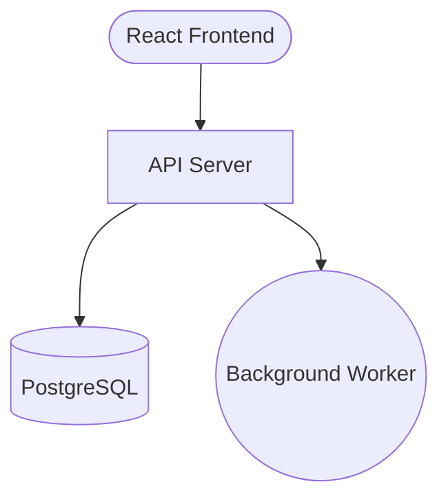

# CLI Reference

Complete reference for all Brick CLI commands and options.

## Global Options

```bash
brick --version    # Show version number
brick --help       # Show help
brick <command> --help  # Show help for a specific command
```

---

## brick build

Compile a Mermaid diagram into a DigitalOcean AppSpec YAML file.

```bash
brick build <diagram> [options]
```

### Arguments

| Argument | Description |
|----------|-------------|
| `<diagram>` | Path to the Mermaid diagram file (.mmd) |

### Options

| Option | Default | Description |
|--------|---------|-------------|
| `-o, --output <file>` | `appspec.yaml` | Output file path |
| `-n, --name <name>` | From diagram | Override app name |
| `-r, --region <region>` | `nyc` | Override region (nyc, sfo, ams, etc.) |

### Examples

```bash
# Basic build
brick build architecture.mmd

# Custom output file
brick build architecture.mmd -o my-app.yaml

# Override name and region
brick build architecture.mmd -n production-api -r sfo
```

### Mermaid Diagram Format

Brick parses standard Mermaid flowchart syntax with shape-based component inference:



See [Architecture](architecture.md) for complete diagram syntax.

---

## brick create

Generate infrastructure from a natural language description using AI.

```bash
brick create <description> [options]
```

### Arguments

| Argument | Description |
|----------|-------------|
| `<description>` | Natural language description of your application |

### Options

| Option | Default | Description |
|--------|---------|-------------|
| `-o, --output <file>` | `appspec.yaml` | Output file path for the AppSpec |
| `-d, --diagram <file>` | - | Also save the generated Mermaid diagram |
| `-y, --yes` | `false` | Skip confirmation prompts |

### Examples

```bash
# Basic creation
brick create "A blog with Next.js and PostgreSQL"

# Save both diagram and spec
brick create "An e-commerce site with React and a Python API" \
  -o shop.yaml \
  -d shop.mmd

# Skip confirmation
brick create "Simple static website" -y
```

### Requirements

- `ANTHROPIC_API_KEY` environment variable must be set
- Internet connection for API calls

---

## brick chat

Interactive mode for designing and refining architecture through conversation.

```bash
brick chat [options]
```

### Options

| Option | Default | Description |
|--------|---------|-------------|
| `-o, --output <file>` | `appspec.yaml` | Output file path when building |

### Interactive Commands

| Command | Description |
|---------|-------------|
| `/build` | Generate AppSpec from current architecture |
| `/show` | Display current Mermaid diagram |
| `/reset` | Clear conversation and start over |
| `/quit` | Exit interactive mode |

### Example Session

```
$ brick chat

Welcome to Brick Interactive Mode

Describe your application and I'll design the architecture.

> A SaaS platform with user management and billing

Architecture:

flowchart TD
    A([Dashboard]) --> B[User API]
    A --> C[Billing API]
    B --> D[(PostgreSQL)]
    C --> D

This architecture includes:
- Dashboard: React SPA for the user interface
- User API: Handles authentication and user management
- Billing API: Processes subscriptions and payments
- PostgreSQL: Stores user and billing data

> Add Redis for session caching

Architecture:

flowchart TD
    A([Dashboard]) --> B[User API]
    A --> C[Billing API]
    B --> D[(PostgreSQL)]
    C --> D
    B --> E[(Redis)]

Added Redis cache connected to the User API for session storage.

> /build
AppSpec written to appspec.yaml
```

---

## brick deploy

Deploy an AppSpec to DigitalOcean App Platform.

```bash
brick deploy <appspec> [options]
```

### Arguments

| Argument | Description |
|----------|-------------|
| `<appspec>` | Path to the AppSpec YAML file |

### Options

| Option | Default | Description |
|--------|---------|-------------|
| `-y, --yes` | `false` | Skip confirmation prompts |
| `--dry-run` | `false` | Show deployment plan without deploying |

### Examples

```bash
# Interactive deployment
brick deploy appspec.yaml

# Skip confirmation
brick deploy appspec.yaml -y

# Preview without deploying
brick deploy appspec.yaml --dry-run
```

### Prerequisites

- `doctl` must be installed and authenticated
- Valid DigitalOcean account with payment method

### Output

```
Deployment Summary:
  App Name: my-app
  Region: nyc
  Estimated Monthly Cost: $12.00/month

  Components:
    - api-server (service): $5.00
    - postgresql (database): $7.00

Deploy this application? (y/N) y

Deploying to DigitalOcean...
Deployment started successfully!

App URL: https://my-app-xxxxx.ondigitalocean.app
Dashboard: https://cloud.digitalocean.com/apps/xxxxx
```

---

## brick validate

Validate an AppSpec YAML file without deploying.

```bash
brick validate <appspec>
```

### Arguments

| Argument | Description |
|----------|-------------|
| `<appspec>` | Path to the AppSpec YAML file |

### Examples

```bash
brick validate appspec.yaml
```

### Output (Valid)

```
✓ AppSpec is valid

Warnings:
  - Region 'us-east' may not be valid. Valid regions include: nyc, sfo, ams, sgp, lon, fra
```

### Output (Invalid)

```
✗ AppSpec validation failed

Errors:
  - App name must start with a letter, contain only lowercase letters, numbers, and hyphens
  - Service 'api' must have a source (git, github, or image)

Warnings:
  - Database 'cache' has engine 'memcached' which is not supported
```

### Validation Rules

- App name: lowercase, alphanumeric with hyphens, max 32 characters
- All components must have unique names
- Services, workers, jobs need a source (git, github, or image)
- Database engines must be: PG, MYSQL, REDIS, or MONGODB
- Job kinds must be: PRE_DEPLOY, POST_DEPLOY, or FAILED_DEPLOY
- HTTP ports must be between 1 and 65535

---

## brick ui

Launch a visual architecture editor in your browser.

```bash
brick ui [options]
```

### Options

| Option | Default | Description |
|--------|---------|-------------|
| `-p, --port <port>` | `3000` | Port to run the UI server |

### Features

The visual UI provides:

- **Drag-and-drop components** - Add services, databases, workers, jobs
- **Visual connections** - Draw connections between components
- **Real-time cost estimation** - See costs update as you design
- **Template library** - Start from common architecture patterns
- **Code generation** - Generate boilerplate code for components
- **Export options** - Export to Mermaid, AppSpec YAML, or JSON

### Component Types

The UI supports a comprehensive set of component types:

**Compute:**
- Service (backend API)
- Static Site (frontend)
- Worker (background process)
- Job (scheduled task)
- Function (serverless)
- Container

**Data:**
- Database (PostgreSQL, MySQL, MongoDB)
- Cache (Redis)
- Queue (message broker)
- Storage (object storage)
- Search (Elasticsearch)

**Infrastructure:**
- API Gateway
- Load Balancer
- CDN
- DNS
- Firewall

**Platform Services:**
- Auth
- Monitoring
- Logging
- Secrets
- Registry

**External:**
- Email
- Payment
- Analytics
- ML Model
- Third Party

---

## brick server

Start the Brick platform server for team collaboration and programmatic access.

```bash
brick server [options]
```

### Options

| Option | Default | Description |
|--------|---------|-------------|
| `-p, --port <port>` | `4000` | Port to run the server |

### Environment Variables

| Variable | Description |
|----------|-------------|
| `BRICK_DO_TOKEN` | DigitalOcean API token for deployments |
| `BRICK_DB` | Set to `sqlite` for persistent storage |
| `BRICK_DB_PATH` | Path to SQLite database file |

### API Endpoints

The server exposes a REST API:

**Authentication:**
- `POST /api/auth/login` - Login with email/password
- `POST /api/auth/register` - Register new user

**Projects:**
- `GET /api/projects` - List user's projects
- `POST /api/projects` - Create a new project
- `GET /api/projects/:id` - Get project details
- `PATCH /api/projects/:id` - Update a project
- `DELETE /api/projects/:id` - Delete a project

**Deployments:**
- `POST /api/deployments/:projectId/:environment` - Start deployment
- `GET /api/deployments/:deploymentId` - Get deployment status
- `GET /api/deployments/:deploymentId/logs` - Stream deployment logs
- `DELETE /api/deployments/:projectId/:environment` - Stop deployment

**Other:**
- `GET /api/usage/current-month` - Get AI usage statistics
- `GET /api/preferences` - Get user preferences
- `GET /health` - Health check

### WebSocket Support

The server includes WebSocket support for real-time collaboration:
- Live architecture editing
- Deployment log streaming
- Team presence indicators

### Example

```bash
# Start with default settings
brick server

# Start on custom port with SQLite
BRICK_DB=sqlite BRICK_DB_PATH=./brick.db brick server -p 8080
```

Output:
```
╔═══════════════════════════════════════════════════╗
║                                                   ║
║   Brick Platform Server                           ║
║                                                   ║
║   Running on: http://localhost:4000               ║
║                                                   ║
║   Endpoints:                                      ║
║   • POST /api/auth/login                          ║
║   • GET  /api/projects                            ║
║   • POST /api/deployments/:project/:env           ║
║                                                   ║
╚═══════════════════════════════════════════════════╝
```
