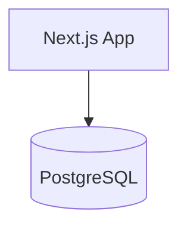
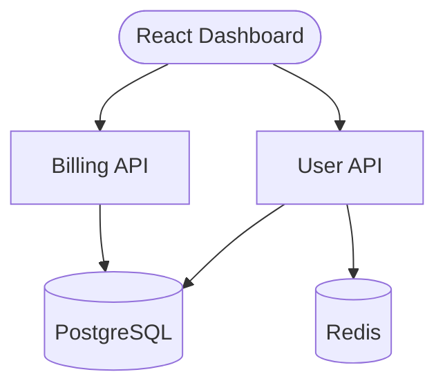
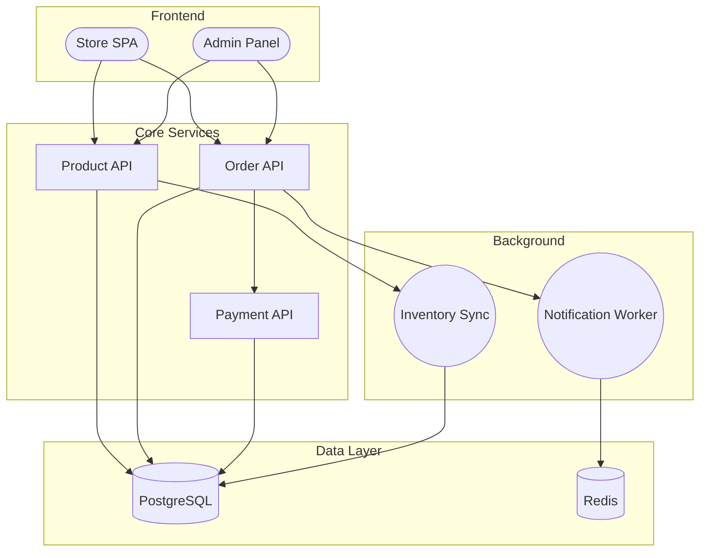
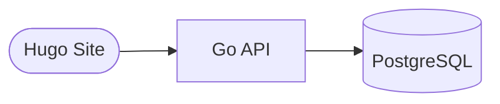
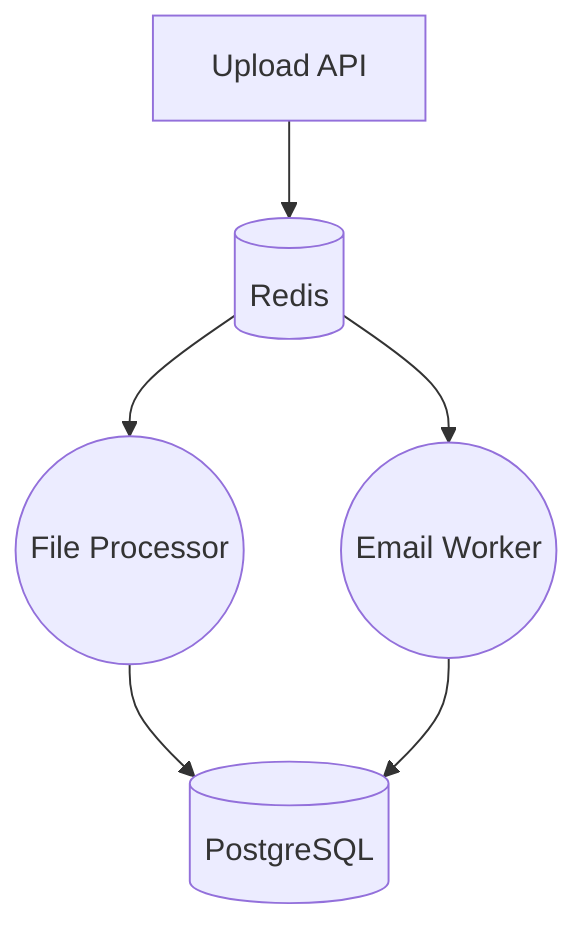
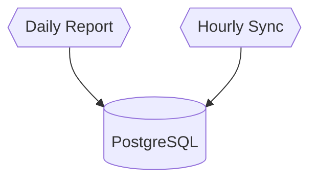
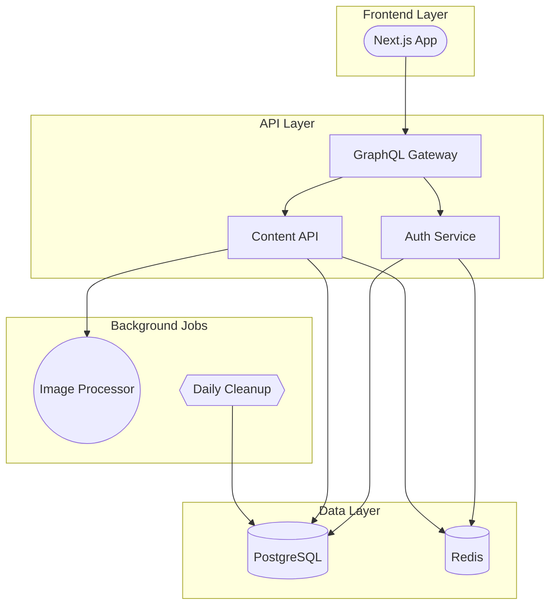

# Example Architectures

Common architecture patterns and how to implement them with Brick.

## Simple Blog

A Next.js blog with PostgreSQL for storing posts and user data.

### Natural Language

```bash
brick create "A simple blog with Next.js and PostgreSQL"
```

### Mermaid Diagram



### Generated AppSpec

```yaml
name: blog
region: nyc
services:
  - name: next-js-app
    git:
      repo: https://github.com/your-org/your-repo
      branch: main
    environment_slug: node-js
    http_port: 3000
    instance_count: 1
    instance_size_slug: basic-xxs
    envs:
      - key: POSTGRESQL_URL
        value: ${postgresql.DATABASE_URL}
databases:
  - name: postgresql
    engine: PG
    version: "16"
    size: db-s-dev-database
```

### Estimated Cost

- Next.js App: $5.00/month
- PostgreSQL (dev): $7.00/month
- **Total: $12.00/month**

---

## SaaS with API and Database

A React SPA with separate backend APIs and shared database.

### Natural Language

```bash
brick create "A SaaS platform with React frontend, user API, billing API, and PostgreSQL"
```

### Mermaid Diagram


### Architecture Explanation

- **React Dashboard**: Static SPA served from CDN (free)
- **User API**: Handles authentication, profiles, permissions
- **Billing API**: Manages subscriptions, payments, invoices
- **PostgreSQL**: Primary data store for all user and billing data
- **Redis**: Session cache and rate limiting

### With Annotations



### Estimated Cost

- React Dashboard: Free
- User API (2 instances): $10.00/month
- Billing API: $5.00/month
- PostgreSQL (dev): $7.00/month
- Redis: $15.00/month
- **Total: $37.00/month**

---

## Microservices Architecture

An e-commerce platform with multiple independent services.

### Natural Language

```bash
brick create "An e-commerce platform with product catalog, orders, payments, and notifications"
```

### Mermaid Diagram



### Architecture Explanation

**Frontend:**
- Store SPA: Customer-facing storefront
- Admin Panel: Internal management interface

**Core Services:**
- Product API: Catalog, search, inventory
- Order API: Cart, checkout, order management
- Payment API: Payment processing, refunds

**Background Workers:**
- Notification Worker: Sends emails, SMS, push notifications
- Inventory Sync: Syncs inventory with external systems

**Data Layer:**
- PostgreSQL: Primary database
- Redis: Queue for workers, caching, sessions

### Estimated Cost

- Static sites: Free
- 3 Services: $15.00/month
- 2 Workers: $10.00/month
- PostgreSQL: $7.00/month
- Redis: $15.00/month
- **Total: $47.00/month**

---

## Static Site with API Backend

A Hugo documentation site with a Go API for dynamic features.

### Natural Language

```bash
brick create "A Hugo documentation site with a Go API backend and PostgreSQL"
```

### Mermaid Diagram



### With Build Configuration


### Generated AppSpec

```yaml
name: docs-site
region: nyc
static_sites:
  - name: hugo-site
    git:
      repo: https://github.com/your-org/your-repo
      branch: main
    environment_slug: hugo
    build_command: hugo --minify
    output_dir: public
services:
  - name: go-api
    git:
      repo: https://github.com/your-org/your-repo
      branch: main
    environment_slug: go
    http_port: 8080
    instance_count: 1
    instance_size_slug: basic-xxs
    envs:
      - key: POSTGRESQL_URL
        value: ${postgresql.DATABASE_URL}
databases:
  - name: postgresql
    engine: PG
    version: "16"
    size: db-s-dev-database
```

### Estimated Cost

- Hugo Site: Free (CDN hosted)
- Go API: $5.00/month
- PostgreSQL: $7.00/month
- **Total: $12.00/month**

---

## Event-Driven Data Pipeline

A system for processing file uploads with async workers.

### Natural Language

```bash
brick create "A data pipeline that receives file uploads, processes them with workers, and sends email notifications"
```

### Mermaid Diagram



### Architecture Explanation

- **Upload API**: Receives files, validates, stores in object storage, queues jobs
- **Redis**: Message queue for job coordination
- **File Processor**: Processes files (parse, transform, analyze)
- **Email Worker**: Sends notifications when processing completes
- **PostgreSQL**: Stores processing results and audit logs

### Estimated Cost

- Upload API: $5.00/month
- File Processor: $5.00/month
- Email Worker: $5.00/month
- Redis: $15.00/month
- PostgreSQL: $7.00/month
- **Total: $37.00/month**

---

## Scheduled Jobs

A system with scheduled reports and data synchronization.

### Natural Language

```bash
brick create "An analytics system with daily report generation and hourly data sync jobs"
```

### Mermaid Diagram



### With Schedules


### Architecture Explanation

- **Daily Report**: Runs at 6 AM UTC, generates analytics reports
- **Hourly Sync**: Runs every hour, syncs data from external sources
- **PostgreSQL**: Stores synchronized data and generated reports

### Cron Schedule Reference

| Expression | Meaning |
|------------|---------|
| `0 6 * * *` | Daily at 6 AM |
| `0 * * * *` | Every hour |
| `*/15 * * * *` | Every 15 minutes |
| `0 0 * * 0` | Weekly on Sunday |
| `0 0 1 * *` | Monthly on the 1st |

### Estimated Cost

Jobs are billed per execution, estimated at ~10% of equivalent always-on service:
- Daily Report: ~$0.50/month
- Hourly Sync: ~$0.50/month
- PostgreSQL: $7.00/month
- **Total: ~$8.00/month**

---

## Full-Stack Application with Caching

A complete application with frontend, multiple services, caching, and background processing.

### Mermaid Diagram



### Component Breakdown

| Component | Type | Purpose |
|-----------|------|---------|
| Next.js App | static_site | Server-rendered frontend |
| GraphQL Gateway | service | API aggregation layer |
| Auth Service | service | Authentication/authorization |
| Content API | service | Content management |
| Image Processor | worker | Async image optimization |
| Daily Cleanup | job | Removes stale data |
| PostgreSQL | database | Primary data store |
| Redis | database | Caching, sessions, queues |

### Estimated Cost

- Next.js App: Free (static)
- 3 Services: $15.00/month
- 1 Worker: $5.00/month
- 1 Job: ~$0.50/month
- PostgreSQL: $7.00/month
- Redis: $15.00/month
- **Total: ~$42.50/month**

---

## Tips for Designing Architectures

1. **Start simple** - Begin with the minimum viable architecture and add complexity as needed.

2. **Use appropriate shapes** - Let Brick infer component types from shapes instead of specifying everything manually.

3. **Name things descriptively** - Use names like "User API" instead of just "API" to help Brick infer configurations.

4. **Group related components** - Use subgraphs to organize complex architectures visually.

5. **Consider scaling** - Use annotations to specify instance counts for services that need to handle more traffic.

6. **Leverage caching** - Add Redis when you need session storage, rate limiting, or caching.

7. **Use workers for async tasks** - Don't block HTTP requests with long-running operations.

8. **Schedule maintenance jobs** - Use hexagon-shaped jobs for cleanup, reports, and sync operations.
