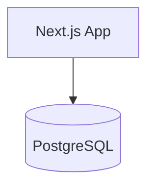

# Getting Started with Brick CLI

This guide walks you through installing Brick, setting up your environment, and deploying your first application to DigitalOcean App Platform.

## Prerequisites

### Node.js 18+

Brick requires Node.js version 18 or higher.

```bash
# Check your Node.js version
node --version

# If you need to install/upgrade, use nvm:
nvm install 18
nvm use 18
```

### DigitalOcean Account

You need a DigitalOcean account to deploy applications:

1. Sign up at [digitalocean.com](https://www.digitalocean.com/)
2. Add a payment method (required for App Platform)
3. Note: Brick provides cost estimates before deployment

### doctl (DigitalOcean CLI)

Brick uses `doctl` to interact with DigitalOcean:

```bash
# macOS
brew install doctl

# Linux
snap install doctl

# Windows
scoop install doctl
```

After installation, authenticate:

```bash
doctl auth init
```

You'll need a DigitalOcean API token from [cloud.digitalocean.com/account/api/tokens](https://cloud.digitalocean.com/account/api/tokens).

### Anthropic API Key (for AI features)

To use AI-powered features (`brick create`, `brick chat`), you need an Anthropic API key:

1. Get an API key from [console.anthropic.com](https://console.anthropic.com/)
2. Set the environment variable:

```bash
export ANTHROPIC_API_KEY=your_api_key_here
```

Add this to your shell profile (`~/.bashrc`, `~/.zshrc`) to persist it.

## Installation

Install Brick globally using npm:

```bash
npm install -g brick-cli
```

Verify the installation:

```bash
brick --version
```

## Configuration

### Environment Variables

| Variable | Required | Description |
|----------|----------|-------------|
| `ANTHROPIC_API_KEY` | For AI features | Anthropic API key for `create` and `chat` commands |
| `BRICK_DO_TOKEN` | For server mode | DigitalOcean token for platform server |
| `BRICK_DB` | Optional | Set to `sqlite` for persistent database |
| `BRICK_DB_PATH` | Optional | Path to SQLite database file |

### LLM Configuration

Brick supports multiple LLM providers. Configure via environment:

```bash
# OpenRouter (alternative provider)
export OPENROUTER_API_KEY=your_key
export BRICK_LLM_PROVIDER=openrouter
export BRICK_LLM_MODEL=anthropic/claude-3-opus
```

## First Deployment Walkthrough

### Option 1: Create from Natural Language

The fastest way to get started is describing your application in plain English:

```bash
brick create "A simple blog with Next.js and PostgreSQL"
```

Brick will:
1. Generate an architecture diagram
2. Show you the proposed components
3. Ask for confirmation
4. Create an `appspec.yaml` file

Review the output:
```bash
cat appspec.yaml
```

Deploy when ready:
```bash
brick deploy appspec.yaml
```

### Option 2: Build from a Mermaid Diagram

Create a file called `architecture.mmd`:



Build the AppSpec:

```bash
brick build architecture.mmd -o appspec.yaml
```

Deploy:

```bash
brick deploy appspec.yaml
```

### Option 3: Interactive Design with Chat

For complex applications, use interactive mode:

```bash
brick chat
```

This opens a conversation where you can:
- Describe your requirements
- See the generated architecture
- Request changes ("add Redis for caching")
- Build the final spec with `/build`

Example session:
```
> A SaaS application with user authentication, payment processing, and a dashboard

Architecture:
flowchart TD
    A([React Dashboard]) --> B[Auth API]
    A --> C[Payment API]
    B --> D[(PostgreSQL)]
    C --> D
    C --> E[(Redis)]

> Add a background worker for processing payments asynchronously

Architecture:
flowchart TD
    A([React Dashboard]) --> B[Auth API]
    A --> C[Payment API]
    B --> D[(PostgreSQL)]
    C --> D
    C --> E[(Redis)]
    E --> F((Payment Worker))
    F --> D

> /build
AppSpec written to appspec.yaml
```

## Deployment Process

When you run `brick deploy`:

1. **Validation** - Brick validates your AppSpec for errors
2. **Cost Estimate** - Shows estimated monthly cost breakdown
3. **Confirmation** - Asks for confirmation (skip with `-y`)
4. **Deployment** - Submits to DigitalOcean App Platform
5. **URL** - Provides your app URL and dashboard link

Example output:
```
Deployment Summary:
  App Name: my-blog
  Region: nyc
  Estimated Monthly Cost: $12.00/month

  Components:
    - next-js-app (service): $5.00
    - postgresql (database): $7.00

Deploy this application? (y/N)
```

## What's Next?

- Read the [CLI Reference](cli-reference.md) for all command options
- Explore [Examples](examples.md) for common architecture patterns
- Learn how Brick works in [Architecture](architecture.md)
- Try the visual UI with `brick ui`

## Troubleshooting

### "doctl is not installed or not authenticated"

Ensure doctl is installed and authenticated:
```bash
doctl auth init
doctl account get  # Verify authentication
```

### "ANTHROPIC_API_KEY not set"

Set your API key:
```bash
export ANTHROPIC_API_KEY=your_key_here
```

### Deployment fails with validation errors

Run validation separately to see detailed errors:
```bash
brick validate appspec.yaml
```

Common issues:
- App name must be lowercase, alphanumeric with hyphens
- App name must be 32 characters or less
- All components need a source (git, github, or image)

### Cost concerns

Use the `--dry-run` flag to see costs without deploying:
```bash
brick deploy appspec.yaml --dry-run
```
